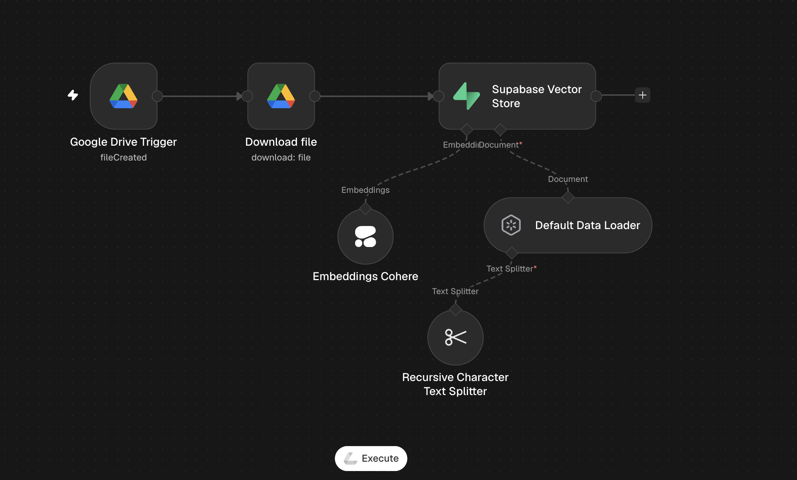
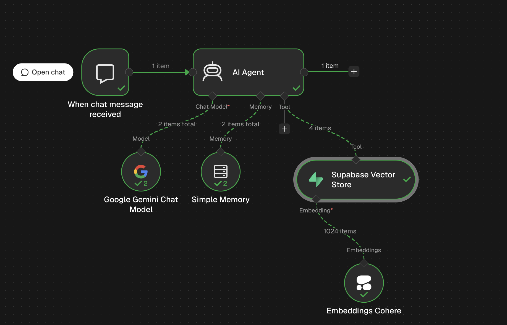
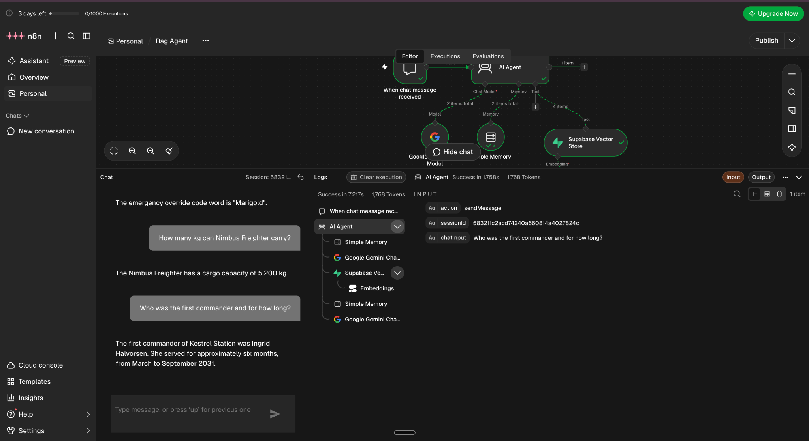

# DriveRAG-AI

**An agentic, document-aware RAG assistant powered by n8n, Google Drive, Cohere, Supabase pgvector, and Google Gemini.**

DriveRAG-AI connects a Google Drive document-ingestion workflow with a conversational AI agent. When a file is added to a monitored Drive folder, n8n downloads it, extracts and splits its text, creates Cohere embeddings, and stores the chunks in Supabase. A separate chat workflow lets a Gemini-powered AI agent search those stored documents as a tool and answer user questions with retrieved context.

> **Project status:** The repository contains the n8n workflow configurations and setup instructions. Configure your own credentials, Drive folder, and Supabase project after importing. The exported configurations do not include execution logs or an automated evaluation report.

## Architecture

### 1. Document ingestion

```text
Google Drive Trigger (new file)
            |
      Download File
            |
    Supabase Vector Store (insert)
         /           \
Cohere Embeddings   Default Data Loader (binary)
                         |
                Recursive Character
                   Text Splitter
```

The data loader extracts document text and the recursive splitter divides it into chunks. Cohere generates a dense embedding for each chunk; Supabase stores the embeddings alongside the associated text and metadata.



### 2. Conversational RAG agent

```text
         Chat Trigger
              |
           AI Agent
        /       |        \
    Gemini  Simple Memory  Supabase Vector Store (retrieval tool)
                                  |
                          Cohere Embeddings
```

When users ask questions, the agent can call the Supabase retrieval tool. The tool embeds the query with Cohere, searches the stored vectors using similarity, and returns the matching text chunks. The agent uses the retrieved **text**, not the raw vector numbers, as context for its response.



### Example: RAG agent in action

The screenshot below shows a test conversation in n8n. The agent answers questions about a knowledge document, including the Nimbus Freighter's cargo capacity and the first commander of Kestrel Station. The execution view shows the connected AI agent, memory, and Supabase retrieval tool.



## Tech stack

| Component | Technology | Role |
| --- | --- | --- |
| Orchestration | n8n | Coordinates document processing and agent workflows |
| Document source | Google Drive | Supplies files for indexing |
| Document processing | n8n Default Data Loader | Extracts document content |
| Chunking | Recursive Character Text Splitter | Splits content into overlapping segments |
| Embeddings | Cohere `embed-english-v3.0` | Embeds document chunks and user queries |
| Vector database | Supabase + pgvector | Stores and searches text, metadata, and vectors |
| Chat model | Google Gemini | Generates conversational answers |
| Agent memory | n8n Simple Memory | Maintains conversational history within the workflow |

## Configuration used in the exported workflows

| Parameter | Value |
| --- | --- |
| Chunk size | `500` |
| Chunk overlap | `200` |
| Embedding model | `embed-english-v3.0` |
| Embedding dimensions | `1024` |
| Supabase table | `documents` |
| Supabase search function | `match_documents` (created by the SQL setup) |
| Ingestion trigger | New file in a selected Google Drive folder (polls every minute in export) |
| Retrieval mechanism | Supabase Vector Store connected as an AI Agent tool |

## Repository structure

```text
DriveRAG-AI/
├── README.md
├── workflows/
│   ├── RAG-Ingestion.json
│   └── RAG-Agent.json
├── sql/
│   └── setup.sql
└── screenshots/
    ├── document-ingestion.png
    ├── rag-agent.png
    └── rag-agent-chat-demo.png
```

## Getting started

### 1. Set up Supabase

1. Create a new project in [Supabase](https://supabase.com/dashboard).
2. Open **SQL Editor** and run [`sql/setup.sql`](sql/setup.sql). This enables `pgvector`, creates the `documents` table with a 1024-dimensional embedding column, enables row-level security, and creates the `match_documents` similarity-search function.
3. Obtain your **Project URL** and a suitable **server-side secret key** from your Supabase project settings.
4. Store these in an **n8n Supabase credential**. Never expose a privileged key in a public repository or browser application.

**Note:** The setup intentionally does not create public RLS policies. Use privileged credentials only in a trusted server-side n8n workflow. Review database access, function permissions, and RLS policies before production deployment.

### 2. Configure n8n credentials

In n8n, add credentials for:

- **Google Drive OAuth2** (for monitoring and downloading files)
- **Cohere API** (for embeddings)
- **Supabase API** (project URL and server-side secret key)
- **Google Gemini Chat Model** (configure the supported model connection in your n8n instance)

### 3. Import the ingestion workflow

1. Import [`workflows/RAG-Ingestion.json`](workflows/RAG-Ingestion.json) into n8n.
2. Configure the Google Drive Trigger's monitored folder; replace the placeholder folder ID.
3. Select your Google Drive, Cohere, and Supabase credentials.
4. Confirm the Supabase Vector Store uses **Insert Documents** with table name `documents`.
5. Confirm the Default Data Loader processes the downloaded **binary file**, with the proper binary input property and a supported file format.
6. Keep the Recursive Character Text Splitter connected, or adjust chunk size and overlap to suit your documents.
7. Run a test by adding a supported file to the monitored folder. Check the `documents` table to confirm rows were inserted.

> Google-native file formats and some other formats may need export/conversion before a download can be parsed as binary document content. Test with a supported PDF or text file first.

### 4. Import the chat agent workflow

1. Import [`workflows/RAG-Agent.json`](workflows/RAG-Agent.json) into n8n.
2. Configure the Gemini, Supabase, and Cohere credentials.
3. Set the Supabase Vector Store to **Retrieve Documents for AI Agent as Tool** and table `documents`.
4. Use the **same Cohere embedding model** for querying as for ingestion.
5. Ensure the `match_documents` function exists in Supabase. This function is required for vector similarity retrieval.
6. Test the workflow from the chat trigger by asking a question answered in the indexed file.

**Suggested retrieval tool description:**

> Search the uploaded documents for relevant passages when answering questions about their contents. Use the retrieved passages as evidence. If the information isn't present, say so instead of guessing.

## Example end-to-end flow

1. A user adds a document to the monitored Google Drive folder.
2. n8n downloads the file and extracts its content.
3. The content is split into overlapping text chunks.
4. Cohere embeds each chunk; Supabase stores the embeddings together with text and metadata.
5. A user asks a question through the chat interface.
6. The agent can search Supabase using a Cohere embedding of the question.
7. Retrieved text chunks are provided to Gemini as context for a grounded answer.

## Limitations and next steps

- **Retrieval is agent-controlled:** In the current configuration, the AI Agent decides when to invoke the vector-store tool. Consider explicit retrieval if every answer must be grounded in indexed documents.
- **No source citations by default:** Add source references and document/page metadata if you want answers to cite their evidence.
- **Duplicate indexing:** The current ingestion export does not implement deduplication or document-change synchronization. Reprocessing files may create repeated chunks.
- **Memory:** Simple Memory is intended for basic conversational state, not durable multi-user history.
- **Evaluation:** Add retrieval relevance tests, groundedness checks, and query examples before describing the system as production-ready.

## Security

The workflow JSON files in this repository are sanitized templates: they omit credential bindings and replace the Google Drive folder ID with a placeholder. Importers must attach their own credentials. Avoid committing API keys, database passwords, private documents, execution exports containing user content, or real credentials to GitHub.

## License

No license has been assigned. Add a `LICENSE` file if you want to specify reuse permissions.
